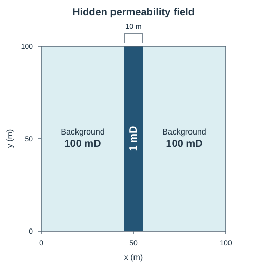

# LLM-assisted model discovery: a history-matching experiment

This experiment adapts ideas from [Murphy's (2026) Model Discovery Agent (MDA)](#relationship-to-murphy-2026) to a simple history-matching problem: inferring a hidden permeability field from synthetic pressure observations.

Pi/LLM proposes geological **model structures**, while **ES-MDA** fits their permeability parameters. Residuals guide revisions, validation scores rank models, and protected final observations test the frozen model's pressure forecasts under predefined changes in injection and production rates.

The experiment:

1. Generates the hidden field and noisy pressure observations.
2. Fits and assesses an initial homogeneous model structure.
3. Lets the agent propose alternative model structures, then uses ES-MDA to fit each structure's permeability parameters to the conditioning observations.
4. Locks in the selected model and its fitted ensemble before the final test.
5. Grades against truth and final observations withheld during search.

**Operator-only:** this README describes the hidden truth. Do not give it to the hypothesis-proposing agent, called the *proposer* in the code.

## Quick start

Requires `uv` and Node.js 22.19 or newer. Python requirements are defined in [`pyproject.toml`](pyproject.toml).

First complete the [one-time Pi dependency setup](#one-time-pi-dependency-setup). The host automatically reuses your active OpenCode Copilot login; [sign in](#copilot-login-without-an-api-key) if needed.

**Output warning:** each invocation deletes the configured `output` directory and starts a new experiment. Use a dedicated run directory, not a directory containing the config, working directory, or controller code.

From the repository root:

```bash
cd scientific-harness
uv sync --locked --no-build
uv run python -m controller configs/run.yaml
```

Inspect the agent's proposals, numerical feedback, and independently graded result in the [experiment artifacts](#experiment-artifacts). Scripted checks are optional implementation tests, not a prerequisite. ERT, additional agents, and reservoir integrations are not needed.

## Which measurements can the agent see?

Observations are synthetic, noisy pressure measurements at four gauges.

| Measurements | Purpose | What the agent receives |
| --- | --- | --- |
| **Conditioning**, 0–32 hours | Fit each hypothesis's parameters to these 64 observations. | Raw observations, times/locations, predictions, and residuals. |
| **Validation**, 32–48 hours | Rank hypotheses using 32 observations excluded from parameter fitting. | Validation scores, not raw observations. These scores guide search. |
| **Protected final**, 48–64 hours | Grade the frozen selection using 32 further observations. | Nothing during search. |

The agent can see the fixed well locations and injection/production schedule, but cannot change them. The true permeability field and parameters are stored under `protected/` with the final observations and are never sent to the proposer.

The agent can use validation scores to revise its hypotheses, even though it cannot see the validation measurements. Only the protected final period remains independent of search. Truth-generation seeds and truth-recovery metrics must also stay out of proposer context.

## Fixed hidden geology

Every CLI run uses the same **100 m × 100 m** permeability field:



- **Background:** 100 mD.
- **Vertical band:** a low-permeability strip at 1 mD, 10 m wide, centered at x = 50 m and spanning the full y-direction. “Vertical” refers to the 2D map, not depth.

The agent starts from a homogeneous hypothesis and may propose vertical or horizontal bands with different centers and widths.

`PressureCase` contains only known experiment settings. Hidden geometry is passed separately to `prepare_case()`; proposed geometry belongs to each `Hypothesis`. Band field generation requires explicit geometry, with no default layout in the public case settings.

## YAML run configuration

The CLI accepts one YAML filename and supports GitHub Copilot only. The [Quick start](#quick-start) runs [`configs/run.yaml`](configs/run.yaml).

Setting groups and defaults:

- **Ensemble:** 50 realizations per candidate (`realizations: 50`), with inference seed `7`. Realizations share a geometry but vary in permeability parameters.
- **Search budget:** `max_evaluations: 3`, including the initial homogeneous hypothesis. This is a cap, not a required count. The simulator-call budget is derived as `5 × realizations × max_evaluations`, or 750 by default.
- **Model budgets:** `max_model_calls: 6`, `max_model_cost_usd: 5.0`; both must be positive.

The YAML config is not sent to the proposer. Use `python -m controller --help` for CLI usage.

## How the scientific harness works

The harness separates **model-structure search** from **parameter fitting** through two loops:

- **Outer loop:** Pi/LLM proposes geological model structures using observations and numerical feedback.
- **Inner loop:** The controller holds each structure fixed, fits its parameter ensemble with ES-MDA, and scores its forecasts.

A **hypothesis** in the API is a proposed model structure. Each **candidate** pairs one structure with a parameter ensemble for numerical evaluation.

| Term | Meaning here |
| --- | --- |
| **Model structure**, `m` | The assumed layout: the same permeability everywhere (**homogeneous**), or one vertical or horizontal low-permeability strip (**band**). For a band, the structure also specifies its position and width. The pressure equation stays fixed. |
| **Model parameters**, `θ` | The numbers describing how easily fluid flows through each region: the background permeability and, for a band, its permeability relative to the background (the band/background ratio). ES-MDA adjusts these numbers to fit the pressure measurements. |
| **Predictive check / adequacy gate** | Conditioning and validation **RMSE** (root mean squared error) check used to permit an `adequate` search outcome; not a calibrated statistical test. |

The code calls the three pattern types **families**: `homogeneous`, `vertical_band`, and `horizontal_band`. A band is represented by the simulation-grid cells whose centers lie inside it. Those cells stay fixed during parameter fitting; a later LLM proposal can choose a different band.

For example, a background permeability of **100 mD** and a band/background ratio of **0.02** give a band permeability of **2 mD**.

The LLM cannot edit code, run shell commands, or control individual numerical updates.

The controller executes only one candidate at a time per campaign, across direct Python clients and the HTTP worker.

### A complete agent run

```text
Prepare hidden truth and observations
  → Controller conditions the initial homogeneous model structure
  → Pi receives agent-visible information, scores, and residuals
  → Pi proposes one model structure with its rationale
  → Controller validates, reserves budget, and queues it
  → Worker samples a parameter prior ensemble and runs:
      [generate fields → simulate → update parameters] × 4
        → full-history forecast → validation scores
  → Host waits, then feeds the result into the next Pi turn
  → Search stops; controller ranks candidates and freezes the selected structure/ensemble
  → Independent evaluator reports final scores and truth recovery
```

Each successful candidate uses **250 simulator calls** by default: **50 realizations** are simulated in each of **four ES-MDA iterations**, then once more for the full-history forecast.

### Pi host and controller contract

[`runProposer()`](agent/src/proposer.ts) uses [`pi-agent-core`](../packages/agent/README.md#tools) for the conversation and tools, [`pi-ai`](../packages/ai/README.md) for model access, and [`pi-schema`](../packages/schema/README.md) for closed [tool and response schemas](agent/src/contracts.ts). Each turn permits at most one accepted `evaluate_hypothesis` or `finish_search` action.

The controller API is an application-specific HTTP bridge, not a built-in Pi-to-Python execution API. See:

- [`controller/server.py`](controller/server.py) — `ScientificHandler.handle_operation()` defines routes and request handling.
- [`agent/src/controller.ts`](agent/src/controller.ts) — host requests and waiting.
- [`controller/campaign.py`](controller/campaign.py) — validation, geometry checks, budgets, and selection policy.

The API listens only on `127.0.0.1`, has no authentication, and assumes trusted local callers. Only the two domain actions are model tools; reads, waiting, and model-call accounting are host-managed.

Accepted evaluations run independently of HTTP requests. The host waits for completion before its next model request. `succeeded` means the numerical procedure completed, not that the hypothesis is scientifically adequate or recovered the hidden structure.

### Implementation entry points

Paths are relative to `scientific-harness/`.

| Order | Entry point | Responsibility |
| --- | --- | --- |
| 1 | [`controller/__main__.py`](controller/__main__.py) — `main()` | Coordinates configuration, preparation, live search, and protected evaluation. |
| 2 | [`controller/experiment.py`](controller/experiment.py) — `prepare_case()` | Generates truth and observations; separates conditioning/validation from protected truth/final data. |
| 3 | [`cases/pressure.py`](cases/pressure.py) — `PressureCase` | Grid, physical constants, wells/gauges, control schedule, observation ordering, and cutoffs. |
| 4 | [`controller/config.py`](controller/config.py) — `RunConfig`, `load_config()` | Config validation and config-relative output paths. |
| 5 | [`controller/agent_run.py`](controller/agent_run.py) — `run_agent()` | **Agent launch entry point.** Takes evidence/output paths and `RunConfig`; checks dependencies, starts loopback HTTP, and launches Node. |
| 6 | [`agent/src/cli.ts`](agent/src/cli.ts) — `main()` | Selects the live model and credentials, then calls `runProposer()`. |
| 7 | [`agent/src/proposer.ts`](agent/src/proposer.ts) — `runProposer()` | **Main Pi loop.** System prompt, two tools, turn guard, budget reservation, feedback, and transcript. |
| 8 | [`agent/src/controller.ts`](agent/src/controller.ts) — `waitForAcceptedWork()`; [`controller/server.py`](controller/server.py) — `handle_operation()` | Node/Python bridge. |
| 9 | [`controller/campaign.py`](controller/campaign.py) — `Campaign` | One search campaign: `submit()` → `execute()` → `complete()` → `finish()`. Derives the simulation budget; owns evidence, budget reservations, equivalent-proposal reuse, and recovery. |
| 10 | [`agent/src/contracts.ts`](agent/src/contracts.ts) — `HypothesisSchema`; [`controller/hypotheses.py`](controller/hypotheses.py) — `parse_hypothesis()` | Allowed hypothesis schema and Python geometry validation. |
| 11 | [`controller/candidate.py`](controller/candidate.py) — `condition_candidate()` | **Main numerical loop.** Prior sampling, four updates, checkpoints, forecasts, validation scores, and residuals for one candidate hypothesis. |
| 12 | [`controller/experiment.py`](controller/experiment.py) — `evaluate_selection()` | Verifies frozen selection, opens protected data, calculates recovery metrics, and writes reports. |

### Components of the numerical loop

- [`numerical/geology.py`](numerical/geology.py): `sample_prior()` samples the initial parameter ensemble; `permeability_field()` builds each realization's field.
- [`controller/local.py`](controller/local.py): `LocalExecutor.batch()` executes realizations serially and counts simulator calls.
- [`numerical/pressure.py`](numerical/pressure.py): `PressureModel.simulate()` solves pressure diffusion.
- [`controller/assimilation.py`](controller/assimilation.py): `update_parameters()` calls **ES-MDA**, *Ensemble Smoother with Multiple Data Assimilation*.
- [`numerical/evaluation.py`](numerical/evaluation.py): `predictive_scores()` computes forecast scores and uncertainty intervals.

### Optional scripted integration checks

To check the implementation without model calls, verify the **same fixed case and ensemble of 50 realizations used by the CLI** after the Python and [Node/Pi dependency setup](#one-time-pi-dependency-setup). From this directory:

```bash
uv run --locked --no-build pytest \
  tests/test_agent_run.py::test_default_scripted_experiment_fits_and_grades_the_fixed_case -v
```

This runs a scripted Pi search with the real numerical solver, checks the fitted ensemble dimensions, and independently grades the frozen selection for structural and parameter recovery. It uses 500 simulator calls and two scripted model responses. Artifacts are written to pytest's temporary directories, not an existing CLI output directory.

This is an integration check, **not evidence of LLM discovery**. A `SKIPPED` result means Node >=22.19 or the local Pi dependencies are missing, not that the bridge passed.

For launcher and configuration coverage:

```bash
uv run --locked --no-build pytest tests/test_config.py tests/test_cli.py tests/test_agent_run.py -v
```

Configuration and CLI policy tests use mocks.

## Experiment artifacts

Numerical wall time excludes live model requests, case preparation, and protected grading.

If a stage fails, the CLI stops and retains artifacts from that attempt until the next invocation replaces the output, as described in the [Quick start](#quick-start).

The CLI prints the final JSON report, including its file path. `.npz` artifacts contain NumPy arrays; SHA-256 checksums detect changed files.

The SQLite ledger owns accepted evaluations, statuses, and budget accounting; immutable artifact files hold numerical ensembles, checkpoints, and frozen decisions. The transcript records proposals, tool calls, and feedback for audit.

In artifact and API names such as `evidence/`, `evidence.json`, and `/v1/evidence`, **evidence** means the observation data and metadata. It does not mean Bayesian **model evidence**: the marginal likelihood obtained by integrating a likelihood over a model's parameter prior. This controller does not compute that quantity.

Saved experiments whose case settings include `band_width_fraction` must be regenerated.

Main outputs:

```text
runs/experiment-01/
  evidence/
    evidence.json          # Grid, controls, units, observation IDs, and artifact hashes
    conditioning.npz       # Observations used by ES-MDA
    validation.npz         # Ranking observations; raw values not sent to the LLM
  search/
    campaign.json          # Evidence reference, limits, and source/package versions
    ledger.sqlite          # Durable evaluations, costs, and budget reservations
    run.json               # Evidence/selection hashes and source/package versions
    selection.json         # Frozen ranking, failures, counts, and costs
    proposer/
      messages.jsonl       # Pi transcript, without protected truth or operator config
      summary.json         # Model and usage summary
    h_.../                 # One directory for each evaluated hypothesis
      candidate.json      # Hypothesis, priors, and conditioning settings
      step_00_pending.*    # Pre-update parameters, responses, noise draws, IDs, and RNG state
      step_00_committed.*  # Updated parameters; repeated through step_03
      posterior.npz       # Fitted ensemble and forecasts, with and without measurement noise
      result.json         # Status, scores, residuals, counts, and timing
  protected/
    truth.json             # Hidden family/parameters and observation-noise metadata
    truth.npz              # Generating permeability field and noise-free responses
    final.npz              # Final observations, never opened by the proposer
    evaluation/
      report.json          # Final scores and truth-recovery metrics
      diagnostics.png      # Truth/posterior fields and pressure forecasts at four gauges
```

`diagnostics.png` compares truth and posterior fields on a shared log-permeability scale. The posterior field is the geometric mean across realizations.

Pressure panels show the predictive mean, 90% intervals (5th–95th percentiles), noise-free truth, observations, and cutoffs at 32 and 48 hours.

## Run the agent

### One-time Pi dependency setup

From the repository root, build one coherent local Pi artifact set following the root README:

```bash
npm run pack:packages -- --out .artifacts/scientific-pi
node scripts/use-local-packages.mjs \
  --manifest .artifacts/scientific-pi/manifest.json --consumer scientific-harness/agent \
  --package @earendil-works/pi-agent-core --package @earendil-works/pi-ai \
  --package @earendil-works/pi-schema
cd scientific-harness/agent
npm install --ignore-scripts
cd ..
```

Reuse `.artifacts/scientific-pi/manifest.json` if it already exists. To rebuild, use a new artifact directory and rewire the consumer with its manifest. `package.json` and `package-lock.json` pin content-addressed local tarballs; keep that artifact set available.

### Run the complete experiment

Follow the [Quick start](#quick-start). The controller runs from `scientific-harness/`, the directory containing `pyproject.toml` and `controller/`, not the repository root or `agent/`.

### What instructs the agent?

The LLM's instructions are `SYSTEM_PROMPT` in [`agent/src/proposer.ts`](agent/src/proposer.ts). Each turn also receives agent-visible information, evaluated hypotheses/results, and remaining budgets.

The agent uses **residuals**—simulated pressure minus measured pressure—to identify mismatches and propose a different permeability layout. The prompt asks it to explain these mismatches using the conditioning observations and known well controls. Validation scores also guide its proposals.

Residuals supplied to the agent use the ensemble mean pressure and are divided by the measurement-noise standard deviation:

```text
(mean simulated pressure - measured pressure) / measurement-noise standard deviation
```

Diagnostics are grouped by gauge, time, and pulse. Agent-visible pressure observations are changes from initial pressure in bar.

The agent has two tools:

- `evaluate_hypothesis`: validate and queue one candidate for conditioning and validation scoring.
- `finish_search`: freeze an `adequate`, `inadequate`, or `uncertain` outcome. An `adequate` claim must pass the numerical error check below; `uncertain` allows insufficient evidence or budget.

The **hypothesis grammar**, the allowed format for model-structure proposals, permits homogeneous permeability or **one** low-permeability band. The LLM chooses orientation, center, and width. For example:

```json
{
  "hypothesis": {
    "kind": "band",
    "orientation": "horizontal",
    "center_fraction": 0.4,
    "width_fraction": 0.2
  },
  "reason": "Test whether a horizontal band explains the directional pressure residuals."
}
```

A band runs across the map, is 10–50% wide by default, and must cover at least two rows or columns while leaving space on both sides.

The band's orientation, position, and width stay fixed while ES-MDA fits the permeability values. ES-MDA updates background permeability and **contrast**, the band/background permeability ratio. This lets the prior describe the band's relative permeability rather than an independent absolute value. Log and logit transforms enforce positive permeability and a less-permeable band without clipping; this is a modeling choice, not an ES-MDA requirement.

Priors, likelihood, observation error, solver, cutoffs, and scoring remain controller-owned and fixed. Diagonal bands, multiple bands, and new pattern types are unsupported.

Bands with the same orientation that cover the same grid cells reuse the existing evaluation and simulation reservation. Repeated model requests still consume model budget.

The prompt discourages equivalent repeats but does not prescribe a vertical-then-horizontal sequence. YAML has no prompt or strategy setting.

### Limits and the pressure-error check

The default output limit is 1024 tokens per model request.

The controller atomically reserves simulation calls and **catalog-estimated** model costs in SQLite, preventing concurrent requests from overspending. Reservations use conservative input/protocol estimates, maximum output, and the most expensive catalog tier. Catalog estimates do not measure Copilot quota. Request retries are disabled; unknown outcomes retain their reservations.

An `adequate` claim requires the validation-selected hypothesis's conditioning and validation **RMSE** to be within two observation standard deviations: 2000 Pa here.

This **adequacy gate** is a prototype noise-based predictive check, **not proof of geological truth** or a statistically calibrated adequacy test.

### Copilot login without an API key

The shipped `configs/run.yaml` selects `gpt-6.1-sol`. The host automatically reads the active Copilot account through `opencode auth export github-copilot`, keeping credentials in memory. No auth-file environment variable is needed.

If you are not signed in, complete the one-time device flow:

```bash
opencode auth login github-copilot
```

Then run the normal controller command. To use a Pi login or an explicitly selected credential file instead, set `SCIENTIFIC_COPILOT_AUTH_FILE` to its private `auth.json`; that override takes precedence over OpenCode. The host reads only Copilot credentials and never modifies the source login.

Choose a chat model enabled for your Copilot account and present in the installed Pi catalog. Credentials do not add models to that catalog, and the launcher never silently substitutes another model.

### Controller recovery policy

One controller process owns each campaign. On restart, queued work is discoverable and completed artifacts are reconciled. Running work without a committed result is marked `interrupted`, charged its full simulation reservation because the actual count is unknown, and **not automatically rerun**. A lost Pi conversation or HTTP wait does not cancel accepted work. This recovery policy applies to direct controller use; each CLI invocation replaces existing output with a new experiment.

Saved numerical checkpoints support inspection and deterministic replay tests, **not automatic resumption of a partly conditioned candidate**. There is no numerical cancellation API or automatic proposer-conversation resume.

## What the simulator calculates

The simulator solves pressure diffusion:

$$
S\frac{\partial p}{\partial t}
=\nabla\cdot\left(\frac{k(x;m,\theta)}{\mu}\nabla p\right)+q(x,t)
$$

Here `m` specifies the layout, `θ` specifies the permeability values, `S` is storage per unit volume and pressure change, and `q` is the injection/production rate per unit volume. Storage, viscosity, and initial pressure are fixed; exterior boundaries are no-flow. Gravity and multiphase flow are excluded; this is a simplified pressure-inference example, not a realistic reservoir model.

| Setting | Default |
| --- | --- |
| Domain and thickness | 100 m × 100 m, 10 m thick |
| Mesh | 20 × 20 cells, C order: y rows, x columns |
| Background/band truth | 100 mD / 1 mD; 1 mD = `9.869233e-16` m² |
| Truth band geometry | Centered vertical strip, 10 m wide |
| Storage | `1e-9` Pa⁻¹ |
| Viscosity | `1e-3` Pa·s |
| Initial pressure | `2e7` Pa, or 200 bar |
| Time step | 1 hour, backward Euler |
| Observation interval | Every 2 hours at four gauges |
| Measurement error | Independent zero-mean Gaussian, standard deviation 1000 Pa (0.01 bar) |
| Ensemble | 50 realizations, serial execution |
| ES-MDA inflation | `[4, 4, 4, 4]`: observation-error variance multipliers with reciprocal sum equal to one |
| SVD truncation | `1.0`: retain all singular value decomposition modes |
| Localization | None |

[FiPy](https://www.ctcms.nist.gov/fipy/) assembles the finite-volume equations using harmonic face mobility. Permeability and time step are fixed within a realization, so SciPy's sparse LU factorization is reused across time steps. FiPy's [numerical approach](https://www.ctcms.nist.gov/fipy/numerical/index.html) explains the finite-volume discretization.

### Wells and controls

Coordinates are fractions of domain length, in `(x, y)` order. Arrays follow the order within each group below:

| Kind | Name | Fractional coordinates |
| --- | --- | --- |
| Well | `west` | `(0.20, 0.25)` |
| Well | `east` | `(0.80, 0.25)` |
| Well | `south` | `(0.25, 0.20)` |
| Well | `north` | `(0.25, 0.80)` |
| Gauge | `south_west` | `(0.30, 0.30)` |
| Gauge | `south_east` | `(0.70, 0.30)` |
| Gauge | `north_west` | `(0.30, 0.70)` |
| Gauge | `north_east` | `(0.70, 0.70)` |

Wells and gauges map to the containing cell with `column = floor(x_fraction × grid_size)` and `row = floor(y_fraction × grid_size)`, then flat index `row × grid_size + column`. FiPy's 2D cell volumes are areas, so a well's volumetric rate becomes a cell source `q = rate / (cell_area × thickness)`; contributions in the same cell add.

Controls are balanced source/sink pairs. Rates below are multipliers of **`Q = 1e-4` m³/s**, in west/east/south/north well order. Positive rates inject; negative rates produce. Each row applies for eight one-hour steps.

The schedule is fixed across candidates and CLI runs; controls are not permuted or randomized.

| Time (hours) | Steps | West / Q | East / Q | South / Q | North / Q | Use |
| --- | --- | --- | --- | --- | --- | --- |
| 0–8 | 1–8 | +1.0 | -1.0 | 0 | 0 | Conditioning |
| 8–16 | 9–16 | 0 | 0 | 0 | 0 | Conditioning |
| 16–24 | 17–24 | 0 | 0 | +1.0 | -1.0 | Conditioning |
| 24–32 | 25–32 | 0 | 0 | 0 | 0 | Conditioning |
| 32–40 | 33–40 | -0.6 | +0.6 | 0 | 0 | Validation |
| 40–48 | 41–48 | 0 | 0 | 0 | 0 | Validation |
| 48–56 | 49–56 | +0.4 | -0.4 | -0.8 | +0.8 | Protected final |
| 56–64 | 57–64 | 0 | 0 | 0 | 0 | Protected final |

### Observation ordering and forecasts

Sample pressure after solving steps 2, 4, …, 64; there is no observation at time zero. Flatten readings by increasing time, then gauge order `south_west`, `south_east`, `north_west`, `north_east`. Stable IDs combine the step and gauge, for example `step_0002:south_west`.

| Period | Steps / observation count | Role |
| --- | --- | --- |
| 0–32 hours | Steps 1–32 / 64 observations | Conditioning: west/east pulse, relaxation, south/north pulse, relaxation |
| 32–48 hours | Steps 33–48 / 32 observations | Validation: reversed west/east pulse and relaxation |
| 48–64 hours | Steps 49–64 / 32 observations | Protected final: combined changed-rate controls and relaxation |

The cutoffs include their ending observations: conditioning uses 2–32 hours, validation 34–48 hours, and protected final 50–64 hours.

Forecasts rerun the complete history with final conditioned parameters, without resetting pressure at the validation or final cutoff.

## How parameter fitting works

For each proposed layout, ES-MDA adjusts the permeability values to fit the conditioning measurements. The layout stays fixed.

The fitted ensemble represents a range of plausible parameter values, not just one best-fit set. Each realization is one set of permeability parameters for the same layout, not a competing layout. The ensemble approximates the **parameter posterior**: the distribution of parameter values given that layout and the conditioning measurements.

Pressure states are simulated deterministically for each parameter realization; there is no separate stochastic latent-trajectory inference.

The allowed pattern types are `homogeneous`, `vertical_band`, and `horizontal_band`. The pattern type and the grid cells covered by a band define the model structure `m`; ES-MDA does not change them.

- All pattern types fit `log(background permeability / mD)` with prior `Normal(log(100), 0.7)`; `log` is natural.
- Band models also fit `logit(band/background ratio)` with prior `Normal(logit(0.02), 1.3)`, where `logit(r) = log(r / (1-r))`.
- `Normal(mean, std)` uses standard deviation, not variance, as its second argument.
- Decoding requires positive finite permeability and a ratio strictly in `(0, 1)`. Non-finite values, overflow/underflow, or ratios rounded to zero/one cause explicit failures; nothing is silently clipped.
- `X` has shape parameters × realizations; conditioning `Y` has shape observations × realizations. Arrays use float64 and stable realization/observation IDs.

Prior components and realizations are sampled independently. Candidate random-number generators (RNGs) use NumPy's `default_rng(SeedSequence([seed, stream]))`: stream 0 for priors, 1 for update perturbations, and 2 for predictive measurement noise. Each candidate starts these streams from the same inference seed; truth/observation noise uses its separate fixed seed. Candidate/result manifests record the stream seeds, and checkpoints record the advanced RNG state and actual perturbations.

[`controller/candidate.py`](controller/candidate.py) samples a prior once and creates one smoother per candidate with conditioning observations, their variance vector (`1000²` Pa² per observation), and the fixed inflation schedule. Each update simulates the exact current `X` through 32 hours from the common initial pressure; it does not resample parameters between steps. Default shapes are `X = (1, 50)` for homogeneous or `(2, 50)` for a band, and `Y = (64, 50)`.

[`controller/assimilation.py`](controller/assimilation.py) calls the pinned [`iterative_ensemble_smoother`](https://github.com/equinor/iterative_ensemble_smoother) library's two-step API on that candidate's smoother instance:

```text
smoother.prepare_assimilation(Y=..., observation_perturbations=..., truncation=1.0)
smoother.assimilate_batch(X=...)
```

Pre-update checkpoints record parameters, responses, unscaled observation perturbations, inflation, covariance, and RNG state. Independent observation errors give a diagonal covariance; inflation distributes the update strength across four steps rather than applying the data at full strength four times.

Updated parameters are validated and atomically published as separate `committed` artifacts. `pending` files hold pre-update state; `committed` files hold the checked post-update state. Publication requires a local filesystem supporting hard links and never overwrites existing artifacts.

A failed realization aborts its **whole candidate**. No realization is dropped, resampled, retried, or zero-filled. Failures retain stable realization IDs; other hypotheses may continue. Only successful candidates receive forecast scores. The CLI fails if all candidates fail.

## Selection and evaluation

The controller ranks successful candidates by validation **CRPS**, *continuous ranked probability score*. These scores assess pressure predictions, not the probability that a model is true. The controller does not perform evidence-based Bayesian model selection.

CRPS scores the predictive ensemble, including its spread, rather than just the mean prediction. For one observation:

```text
mean |prediction - observation|
  - 0.5 × average |prediction_i - prediction_j| over all realization pairs
```

Scores are averaged over observations; lower is better. Predictive ensembles include measurement error before scoring noisy observations.

Important report fields:

| Field | Meaning |
| --- | --- |
| `crps_pa` | The ensemble prediction score above, in Pa. Used for validation ranking. |
| `rmse_pa` | Root mean squared error of the mean prediction, in Pa. Used for the pressure-error check. |
| `coverage_90` | Fraction of observations within the 90% predictive interval. |
| `interval_width_90_pa` | Mean predictive-interval width, in Pa. |
| `conditioning_rmse_history_pa` | Fitting pressure error before each of the four updates. |
| `conditioning_rmse_final_pa` | Fitting pressure error after all updates. |
| Parameter `mean`, `median`, `q05`, `q95` | Approximate parameter-posterior summaries for the fixed layout; `q05`/`q95` are the 5th/95th percentiles across realizations. |
| `model_cost_estimate_usd` | Frozen catalog estimate for model requests, including retained reservations when usage is unknown. |
| `proposer_mode` | `live_llm`: live requests; `no_model_calls`: no requests recorded, as in direct controller tests; `faux_scripted_smoke_test`: scripted test responses, not learned proposals. |

Before protected evaluation, the controller freezes the validation-selected hypothesis and its fitted ensemble. The evaluator checks the `selection.json` checksum and that run/truth reference the same evidence snapshot. Reports include:

1. `family_recovered`: whether the selected pattern type matches the generating type.
2. `structural_truth_recovered`: whether the type and the actual grid rows/columns covered by its band match. Written center/width values need not be identical if they cover the same cells.
3. `parameter_recovery`, when structure matches: relative median error `abs(median - truth) / truth` and truth coverage by the posterior 90% interval.
4. `log_permeability_rmse`: RMSE between mean posterior and true natural-log permeability fields; plus final predictive scores.

Sparse pressure observations can be consistent with different permeability fields, so report conditioning fit, structural discrimination, parameter recovery, and final predictive quality separately.

ES-MDA supplies an approximate parameter posterior for a fixed layout, not an exact Bayesian posterior or a posterior over model structures; validation ranking is **not a probability that a family is true**. Matched truth/inference grids verify the numerical path, not robustness to structures outside the grammar. Interval coverage on these examples does not establish uncertainty calibration across other experiments.

## Repeat the experiment

Copy your configured `configs/run.yaml` to `configs/run-11.yaml` and change output and inference seed:

```yaml
output: ../runs/experiment-11
seed: 11
```

Run `uv run python -m controller configs/run-11.yaml`. This seed does not control live LLM randomness.

Reduce `realizations` or `max_evaluations` for a smaller exercise. Model-cost limits apply only to LLM requests, not simulator work.

Directory separation is **not an OS security boundary**. The proposer is restricted through its tools and inputs. Extensions should expose reviewed domain operations over agent-visible information, never the workspace, `protected/`, unrestricted Python, or operator configs.

## Tests and checks

```bash
uv run --locked --no-build pytest tests -v
uv run --locked --no-build ruff check cases numerical controller tests
uv run --locked --no-build ruff format --check cases numerical controller tests
```

Use the existing tests as implementation checks:

| Required behavior | Executable checks |
| --- | --- |
| Fixed controls, stable observation ordering, and disjoint cutoffs | [`tests/test_case.py`](tests/test_case.py) |
| Direct FiPy agreement, volume balance, source normalization, rate scaling, temporal refinement, and distinct responses for the tested families | [`tests/test_pressure.py`](tests/test_pressure.py) |
| ES-MDA matches an analytic linear-Gaussian conditional mean/covariance within finite-ensemble tolerances; invalid arrays fail before updating | [`tests/test_assimilation.py`](tests/test_assimilation.py) |
| Responses match current parameter columns; saved perturbations replay every update; artifacts reject changes/overwrites; failed candidates remain explicit | [`tests/test_experiment.py`](tests/test_experiment.py), [`tests/test_artifacts.py`](tests/test_artifacts.py) |
| Geometry checks, equivalent-proposal reuse, atomic budgets, one active candidate, adequacy checks, and conservative restart accounting | [`tests/test_hypotheses.py`](tests/test_hypotheses.py), [`tests/test_campaign.py`](tests/test_campaign.py) |
| Loopback-only HTTP, restricted agent-visible information, accepted work surviving a lost wait, and a homogeneous negative control | [`tests/test_server.py`](tests/test_server.py) |
| One accepted Pi action per turn, host waiting before the next model call, and rejection of unexpected protected fields | [`agent/test/proposer.test.ts`](agent/test/proposer.test.ts) |
| Scripted search with the default 50 realizations fits the selected hypothesis and grades its frozen result independently | [`tests/test_agent_run.py`](tests/test_agent_run.py) |
| Two truths across three seed sets recover the tested families/parameters, without changing frozen selection during grading | [`tests/test_experiment.py`](tests/test_experiment.py) |

Tests use scripted model responses or direct controller calls and **make no paid model calls**. The two-truth recovery tests exercise numerical fitting and validation ranking through `Campaign`, not LLM discovery. The scripted bridge tests include homogeneous truth as a negative control: no band is needed when the initial hypothesis is adequate.

With Node >=22.19 and local agent dependencies installed, Python also runs Pi/controller integration tests; otherwise they skip. In `agent/`, run `npm run check` and `node --experimental-strip-types --test test/proposer.test.ts test/copilot-login.test.ts`.

For just the repeated-case experiment:

```bash
uv run --locked --no-build pytest tests/test_experiment.py -v
```

## Relationship to Murphy (2026)

Murphy's MDA learns **mechanistic world models**: scientifically meaningful models that explain observations and predict responses to interventions. This experiment keeps the pressure-diffusion equation fixed and searches only the permeability representation. It adapts MDA's separation between LLM structure proposals and numerical parameter fitting, not the full algorithm (Section 3; Appendix A.3 and A.8). MDA names Murphy's discovery agent, not the ES-MDA inference algorithm.

- **Bounded hypothesis-space expansion:** in Murphy's **M-open** setting, the current hypothesis class can be insufficient and is expanded through new proposals. Here the evaluated candidate pool can grow from the homogeneous model to band structures, but the reviewed grammar never changes; the fixed truth lies within that grammar. This is a bounded analogue of M-open expansion, not open-ended mechanism discovery.
- **Parameter fitting and ranking models by validation scores:** ES-MDA fits the permeability values while holding each proposed layout fixed. Validation **CRPS** (continuous ranked probability score) ranks candidates; the controller does not compute marginal likelihoods, posterior model probabilities, or Bayesian model averaging.
- **Fixed experiment design:** well locations, gauges, and injection/production controls are prescribed. MDA's Value-of-Information experiment selection—choosing what to measure next for its expected benefit—is not implemented.
- **Independent final assessment:** validation scores guide proposals and therefore participate in search. Only protected final observations remain independent of search and assess the frozen selection without refitting.

Bayesian model weighting, adaptive experiment design, and proposals outside the grammar are possible future extensions, not implemented features.

## References

- Murphy, Kevin (2026). *Model Discovery Agent: LLM-Assisted Bayesian Experiment Design for Data-Efficient Discovery of Mechanistic World Models*. Section 3 and Appendix A.3/A.8. Reference key: `murphy2026`; source document: `murphy2026_model_discovery_agent.pdf`.
